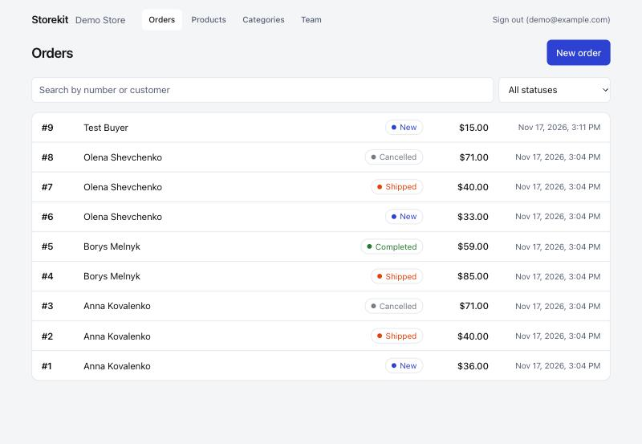
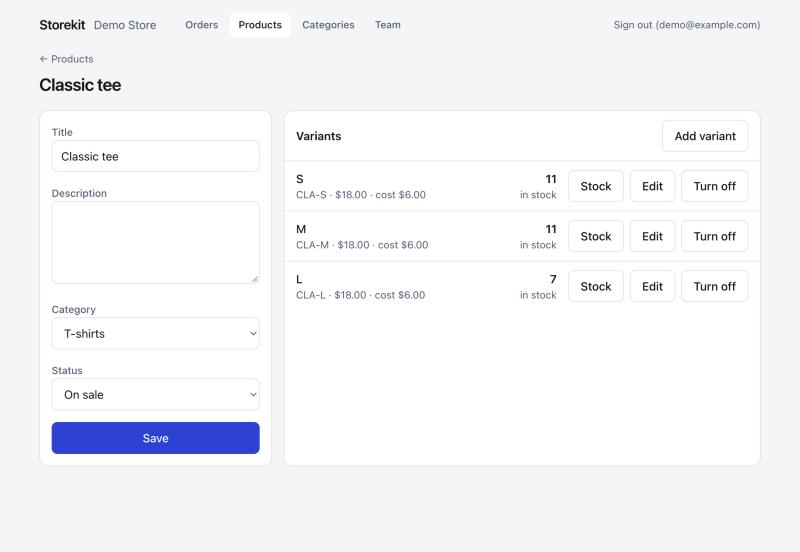
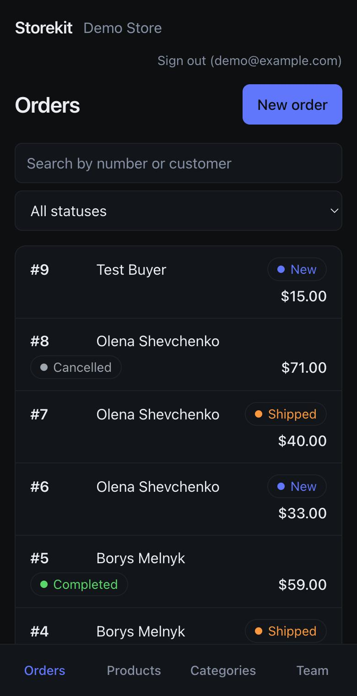

# Storekit

[](https://github.com/max-shlikhta/storekit/actions/workflows/ci.yml)
[](https://github.com/max-shlikhta/storekit/actions/workflows/codeql.yml)
[](LICENSE)

A multi-store back office: one installation runs many independent online stores, each with its
own catalog, stock, customers, orders and team.

> **This is a trimmed demo, not the product.** Storekit is the general core of
> [Chatalog](https://chatalog.com.ua), a platform I built and run for small stores that sell through
> social media (it powers my family's clothing store, [adeli-mood.chatalog.com.ua](https://adeli-mood.chatalog.com.ua)).
> The production repository is private. This one was rewritten from it with everything specific to
> one market, provider or channel removed, so the part that remains can be read end to end. See
> [What was left out](#what-was-left-out).
>
> A live demo of the full product's storefront, with invented data:
> [demo.chatalog.com.ua/shop/lumi_studio](https://demo.chatalog.com.ua/shop/lumi_studio). The admin is
> shown on request. The demo runs on my own hardware, so it may occasionally be offline.

It is a compact, readable reference for a few things that are easy to get wrong in this kind of
system: **tenant isolation**, **stock that never oversells**, an **order status flow** that keeps
its books straight, and **role-based visibility** (staff never see purchase prices).

- **API:** Node.js, Express 5, TypeScript, Sequelize 6, PostgreSQL 17, Zod 4
- **Admin:** Next.js 16 (App Router), React 19, Tailwind CSS 4, phone-first
- **Tests:** `node:test` integration tests against a real PostgreSQL (62 API tests, plus unit tests)
- **CI:** GitHub Actions runs format, lint, typecheck and all tests on every push

## Screenshots

The admin follows the system's light or dark theme and works on a phone.

<p>
  <picture>
    <source media="(prefers-color-scheme: dark)" srcset="docs/screenshots/orders-dark.jpg" />
    
  </picture>
  <picture>
    <source media="(prefers-color-scheme: dark)" srcset="docs/screenshots/product-dark.jpg" />
    
  </picture>
</p>

<p>
  
</p>

## Run it

You need Node.js 24 (22.13+ works) and Docker.

```bash
npm install
cp apps/api/.env.example apps/api/.env
npm run db:up          # PostgreSQL in Docker
npm run db:migrate
npm run db:seed        # a demo store with products and orders
npm run dev            # API on :38491, admin on :38490
```

Open <http://localhost:38490> and sign in as `demo@example.com` with the password the seed prints.

Run everything the CI runs:

```bash
npm run check          # format, lint, typecheck, tests
```

## What is in it

| Area      | What it does                                                                      |
| --------- | --------------------------------------------------------------------------------- |
| Auth      | Email and password (scrypt), 30-day sessions, TOTP two-factor with recovery codes |
| Stores    | Anyone can create a store and becomes its owner; owners add staff                 |
| Catalog   | Categories, products (draft, on sale, archived), variants with SKU, price, cost   |
| Stock     | Every change is a journal row; the shelf count is always the sum of the journal   |
| Customers | Matched by phone within a store                                                   |
| Orders    | `new → confirmed → shipped → completed`, cancel with a reason, full event history |
| Admin     | Orders, products with stock adjustments, categories, team; light and dark themes  |

## Design decisions worth reading

The full write-up with diagrams is in [docs/architecture.md](docs/architecture.md). In short:

1. **Tenant isolation is enforced twice.** Every repository takes `storeId` first and filters by
   it; and every foreign key between store-owned tables is composite `(store_id, id)`, so the
   database itself refuses a row that points into another store. Tests try both.
2. **Stock changes in one place.** `applyStockChange` runs a single atomic `UPDATE … RETURNING`
   that only matches while the result stays in range, and writes the journal row in the same
   transaction. Eight parallel orders for three units sell exactly three.
3. **Deadlocks are designed out.** Orders touch variants in ascending id order, the same order
   the rows are locked in. A test fires crossed orders in parallel and expects no failures.
4. **Money is an integer in minor units**, never a float, including the admin's input parsing.
5. **Staff never see purchase prices.** The API omits them from responses for non-owners and
   refuses them in input; the admin only shows what the API sent.
6. **A store you do not belong to does not exist.** It answers 404, not 403, the same as a store
   that was never created.

## Project layout

```
apps/api/src
  modules/<name>/   model, schema (Zod), repository, service, controller, routes
  shared/           errors, HTTP helpers, security (scrypt, TOTP, secret box), middlewares
  database/         Sequelize setup, associations, migrations
apps/api/test       integration tests (real database)
apps/admin/src      Next.js app (pages, components, API client)
```

## What was left out

Storekit is deliberately small and general. The production product has these on top of it, none
of which are in this repository:

- **Shipping:** carrier integrations (waybills, branch and parcel-locker pickers, parcel tracking).
- **Payments:** an online payment provider with signed webhooks, payment links and an order
  payments journal.
- **Messaging:** a Telegram bot per store for team and customer notifications, and a Telegram
  Mini App storefront.
- **Storefront:** the public, search-engine-indexed shop with its own address per store,
  structured data, a PWA and shopper sign-in (Google, email codes, Telegram).
- **Email:** transactional email with a queue, per-store switches and quota handling.
- **Store features:** holidays and sales with scheduled discounts, free-delivery rules, product
  photos and videos, discounts and option sets, order corrections and returns.
- **Back office:** reports (revenue, profit, margins), expenses, a second admin design, colour
  palettes per store, a platform-level admin and Google sign-in for staff.
- **Operations:** daily encrypted backups, production and demo deployment, and the landing page.

What is kept is the part that is not specific to any of those: tenancy, auth, catalog, stock,
customers and orders. The code here was rewritten and simplified from the production versions,
so it follows the same ideas but is not a copy of that code, and it does not track the private
repository.

## License

[MIT](LICENSE)
