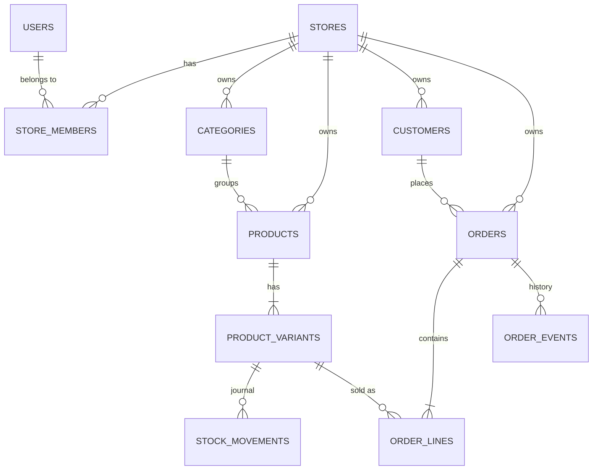
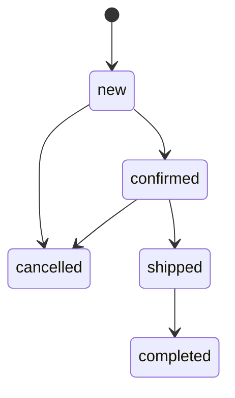

# Architecture

This describes the demo core. The production product it was reduced from (shipping, payments,
Telegram, storefront and more) is private; see "What was left out" in the [README](../README.md).

## Layers

Each module under `apps/api/src/modules/<name>/` has the same shape:

```
routes → controller → service → repository → Sequelize model
```

- **Controllers** parse input with Zod (`parseBody`, `parseInput`, `parseId`) and answer through
  DTO mappers. A model is never sent to the client directly, so a new column cannot leak.
- **Services** hold the business rules and know nothing about Express. They throw `AppError`
  (`VALIDATION_ERROR`, `NOT_FOUND`, `CONFLICT`, …); only the error handler maps those to HTTP.
- **Repositories** are the only place that talks to Sequelize. Every read takes `storeId` first.

Responses have one shape: `{ data }`, lists add `{ meta: { total, limit, offset } }`, errors are
`{ error: { code, message, details? } }`. Every response carries an `x-request-id`.

## Data model



## Tenant isolation

Everything a store owns lives under `/api/v1/stores/:storeId/…`. One middleware, `storeContext`,
decides which store a request is about: it checks the signed-in user's membership and puts the
store on `res.locals`. Controllers take the store from there and never from a request body.

The database backs this up. Each store-owned table has `store_id NOT NULL` and
`UNIQUE (store_id, id)`, and foreign keys between such tables are composite:

```sql
FOREIGN KEY (store_id, variant_id) REFERENCES product_variants (store_id, id)
```

so even a bug in application code cannot attach a row of one store to another's. A test inserts
such a row directly and expects the constraint to refuse it.

## Stock

`product_variants.stock_on_hand` changes only through `applyStockChange`:

```sql
UPDATE product_variants
   SET stock_on_hand = stock_on_hand + :delta
 WHERE store_id = :storeId AND id = :variantId
   AND stock_on_hand + :delta BETWEEN :min AND :max
   AND (:delta > 0 OR stock_on_hand + :delta >= 0 OR (:allowBackorder AND allow_backorder))
RETURNING stock_on_hand
```

No row back means the change was refused (not enough stock, or out of range). The `stock_movements`
journal row is written in the same transaction. Going below zero is possible only for a sale of a
variant that allows backorder, and a CHECK constraint repeats that rule in the database.

## Orders



- Creating an order is one transaction: allocate the number (under the store row's lock), find or
  create the customer, check every line is sellable, take stock, write the lines and the first
  event. If any line is out of stock, nothing is left behind.
- **Lock order** is fixed: the order row (or the store's number counter on create), then variants
  by ascending id. Two orders with the same products therefore never deadlock.
- Order lines are **snapshots**: titles, SKU, price and cost as they were. Changing a price later
  does not touch orders already made.
- Cancelling returns the stock under the order's row lock, so a double cancel cannot return it
  twice. Every status change writes an `order_events` row.

## Authentication

Passwords use scrypt. Sessions are random tokens stored only as SHA-256 hashes. With two-factor
enabled, a sign-in is a half-open session until a TOTP code or a recovery code is given; each
TOTP step is accepted once. Every secret check goes through a rate limiter that counts attempts
in progress, so parallel requests cannot all slip past the limit. An unknown email costs the same
time as a wrong password. A new password ends every other session of the account.

## Roles

| Role  | Can                                                                            |
| ----- | ------------------------------------------------------------------------------ |
| owner | everything in the store: catalog, stock, team, purchase prices                 |
| staff | read the catalog, take and handle orders, manage customers; no purchase prices |

## Admin

The admin reaches the API through its own origin (a Next.js rewrite), so the session cookie stays
first-party and no CORS is needed; the API additionally checks the `Origin` of every request that
changes data. Pages are client components that load data through a small `useResource` hook. All
colours are tokens, light and dark. Inputs are at least 44 px high with a 16 px font, so phones
do not zoom in.
